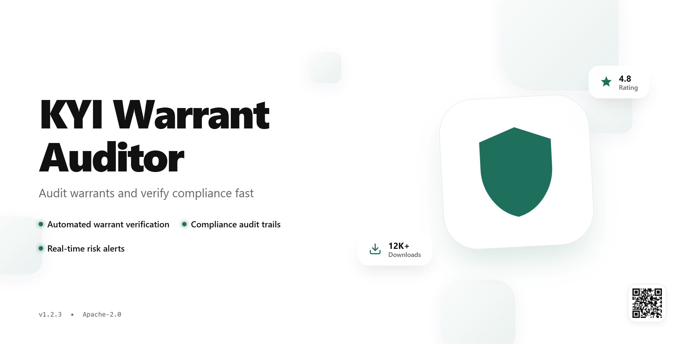

# KYI Warrant Auditor — Security Tool

### 📦 PowerShell Install Button

  

---

KYI Warrant Auditor verifies the authenticity of KYI Warrant by checking signatures, inclusion proofs, and optional anchors. It accepts JSON from an agent, merchant, or export and validates that the signed amount and verdict were not altered after issuance. Both ALLOW and DENY are treated as valid signed records when the cryptographic checks succeed. The auditor runs and requires only Warrant's public key for offline signature verification, with no dependency on a hosted API.

## ✅ Before You Start

- **PowerShell 5.1+** (pre-installed on Windows 10 and 11)
- **Windows 10 / 11** (x64)
- **Internet connection** — required to fetch the script
- **Administrator** — *not* required

## Features

**Signature verification ():** Confirms the body was signed by the Warrant key identified in `signature.key_id`. Any modification to amount, verdict, reasons, or action fields after signing causes verification to fail.
- ** inclusion proof:** Validates that the 's leaf hash is part of the published batch tree, binding the individual to a committed batch root.
- ** anchor check:** Optionally queries a public RPC endpoint to confirm the batch is recorded in `ReceiptLog` on the supported chains, requiring an account or API credential.
- **Verdict-agnostic auditing:** Both ALLOW and DENY are treated as first-class signed artifacts. A DENY that verifies cryptographically is still an authentic decision record.
- **Offline-capable core:** With `PUBLIC_KEY_HEX` set in the environment, signature and checks run entirely. Network access is needed only for the step.
- **Dual interface:** A browser-based UI accepts pasted JSON or uploaded `.json` files and renders a card (verdict, reason, action, id) before verification. A headless CLI path produces identical results for scripted or automated review.
- **Tamper demonstration mode:** A built-in option mutates the signed amount to show the verification pipeline rejecting a forged, useful for training and acceptance testing.
- **Canonical JSON handling:** Field ordering is normalized before hashing and signature checks, so verification is deterministic across environments and implementations.
- **Read-only by design:** The auditor consumes public keys and only. It never requires private key material and does not re-execute policy logic — it answers one question: is this authentic and anchored.
- **Minimal footprint:** Single loader entry point, Node.js 18+ runtime, no external service dependency for the cryptographic core, and a small, auditable codebase layout separating the verification pipeline, local API, and UI.

## How It Works

KYI Warrant Auditor verifies the authenticity of a warrant through a deterministic, offline-first pipeline. Each check is independent and reports its own result, so a partial verification is never presented as a full one.

**Verification pipeline**

1. **Body extraction** — The body is isolated by removing the `onchain` field. This ensures that metadata added after signing cannot influence the signature check.
2. **Canonicalization** — The remaining JSON is serialized with fields in a fixed order. Identical input always produces byte-identical output, which is a precondition for reproducible signature verification.
3. **Signature check** — The `signature.sig` value is verified against the body using the warrant issuer's public key. The key is identified per via `signature.key_id`; the key itself is public by design and shared across all signed under the current key generation.
4. ** inclusion** — When a proof is present, it is walked from the 's leaf hash up to the published batch root. A mismatch at any level fails the check.
5. ** anchor** — When enabled, the batch root is queried against the anchoring registry on the configured network (Polygon Amoy, Base, or another supported chain) to confirm the batch was committed. This step requires only a public RPC endpoint and no account or API credential.

If any field of the body — amount, verdict, reasons, or action — is altered after signing, step 3 fails. Tampering is therefore detectable access to any private material.

** semantics**

Both `ALLOW` and `DENY` verdicts are valid signed outcomes. A `DENY` that passes verification is authentic; the auditor reports integrity, not policy correctness. Re-running the underlying decision logic is outside this tool's scope.

**Inputs required**

- The JSON, as exported by the agent, merchant, or record system.
- The issuer's public key, supplied via configuration or the bundled key file.

No account credential is required for the cryptographic checks. confirmation is optional and degrades gracefully: if no RPC is configured, the signature and results remain available and are labeled accordingly.

**Output model**

Each produces a structured result containing the verdict, the stated reason, the action taken, the identifier, and a per-check status for signature, inclusion, and anchor. Checks that were skipped are marked as skipped rather than passed. A tamper demonstration mode is available to confirm that a modified amount is rejected, which serves as a self-test of the verification path.

**Trust boundary**

The auditor holds only public key material. Private signing keys never enter the application. Verification can run entirely offline for the signature and stages, which means results do not depend on the availability or honesty of any remote service.

## Privacy

KYI Warrant Auditor performs verification entirely on the local machine. No data, public keys, filenames, or verification results are transmitted to any remote endpoint during the core signature and checks.

- **Local processing:** Canonicalization, signature verification, and proof validation execute in-process. Inputs are read from the pasted JSON or uploaded file and held in memory for the duration of the verification only.
- **No telemetry:** The tool contains no analytics, tracking, or usage reporting. It does not phone home, and it does not persist to disk unless the operator explicitly exports them.
- **Optional lookups:** When anchoring checks are enabled, the tool queries a public RPC endpoint to confirm that a batch root appears in the log. Only the batch identifier and root are exposed to that RPC; the body itself is never sent. This step is opt-in and can be disabled to keep verification fully offline.
- **Key handling:** Only the Warrant public key is used or required. The auditor never accepts, stores, or requests private keys. The bundled public key is public by design and safe to distribute.
- **Configuration:** Operators may pin `PUBLIC_KEY_HEX` in the local environment so signature checks run any network dependency. No account, API key, or registration is needed for the cryptographic verification path.
- **Operator responsibility:** may contain sensitive business data. Treat exported files as confidential, scrub them before sharing, and avoid committing real to version control.

## FAQ

**Does verification require network access?**
No. Signature and checks run entirely against the JSON and the bundled public key, so they work offline. Only the optional anchor lookup in ReceiptLog needs a public RPC endpoint. No account or API key is involved in any path.

**What happens if a fails signature verification?**
A signature failure means the signed body no longer matches the signature — typically because the verdict, amount, or reason fields were altered after signing. The auditor reports the failure and stops short of treating the as authentic. It does not attempt to repair or reinterpret the payload.

**Is a DENY treated as invalid?**
No. ALLOW and DENY are both legitimate signed outcomes. A DENY that passes signature,, and checks is authentic — it simply records a negative decision. Verification confirms provenance, not the verdict itself.

**Can the tool re-run or override the original policy decision?**
No. The auditor validates that a is genuine and unmodified. It does not re-evaluate policy, recompute verdicts, or substitute its own judgment. Treat it as an authenticity check, not a decision engine.

**Which key is used, and what happens at rotation?**
Each carries a `signature.key_id` referencing the current Warrant public key. That key is public by design and shared across all signed under it until rotation. After rotation, older remain verifiable with the key that signed them; supply the corresponding public key via `PUBLIC_KEY_HEX` when auditing historical batches.

**Is the tool accessible at no cost?**
Yes. KYI Warrant Auditor is distributed under the MIT License, so you can use, modify, and redistribute it licensing fees. There is no paid tier gating verification.

**Can the tool be used to forge or alter?**
No. The bundled tamper mode exists solely to demonstrate that modified fail verification — it produces a deliberately invalid sample for testing, not a valid forgery. Altering any signed field causes the check to fail, which is the intended, observable behavior.

**What input formats are accepted?**
A single as JSON, either pasted into the UI or uploaded as a `.json` file. The CLI accepts a file path. The must include its signature block; the `onchain` field is optional and only affects the anchor check.

**Does verification send data anywhere?**
No. All processing happens in the app or CLI. The only outbound request is the optional RPC call to confirm a batch is anchored — and that call transmits batch identifiers, not contents.

**How do I know a build is genuine?**
Distribute and consume builds only through the project's official release channel. Builds obtained elsewhere may be modified and should not be trusted for audit work.

## Disclaimer

This tool is provided strictly as an audit utility for cryptographic verification. It performs signature validation, inclusion checks, and optional anchoring lookups against the data you supply; it does not generate, modify, or re-issue warrants, and it does not re-execute or re-evaluate any policy logic behind a.

Verification results reflect only the mathematical integrity of the against the supplied public key and, where enabled, the state of the referenced chain at query time. A passing result confirms that the signed fields were not altered after signing and that the is consistent with the published batch data — it is not an endorsement of the underlying decision, the issuer's operational practices, or the accuracy of any off-chain information the references.

You are responsible for obtaining files and public keys from trustworthy sources and for confirming that the key in use is the current, legitimate key for the issuer. Key rotation, compromised signing keys, or fabricated before a key was revoked cannot be detected by this tool. checks depend on third-party RPC endpoints; availability, latency, and reported state are outside the control of this project.

The software is supplied on an as-is basis, warranty of any kind, express or implied, including fitness for a particular purpose or non-infringement. The maintainers accept no liability for decisions made, losses incurred, or damages arising from reliance on audit output. Validate results independently before using them in any consequential context, and treat this tool as one component of a broader verification process rather than a sole authority.

## License

KYI Warrant Auditor is distributed under the MIT License. The license grants permission to use, copy, modify, merge, publish, distribute, sublicense, and sell copies of the software, provided the copyright notice and permission notice are included in all copies or substantial portions of the software.

The software is provided "as is", warranty of any kind, express or implied, including but not limited to the warranties of merchantability, fitness for a particular purpose, and noninfringement. In no event shall the authors or copyright holders be liable for any claim, damages, or other liability, whether in an action of contract, tort, or otherwise, arising from, out of, or in connection with the software or the use or other dealings in the software.

The MIT License applies uniformly to the verification pipeline, the local API, the headless CLI, and the bundled example and public key material. No separate terms apply to individual components.

The bundled public key is published by design for signature verification purposes and carries no additional licensing restrictions beyond those stated above.

Redistributions must preserve the original copyright notice. Modified versions may be distributed under the same terms; the license does not require derivative works to be disclosed, but any distributed derivative must retain the notice.

Copyright (c) — KYI Warrant Auditor contributors.